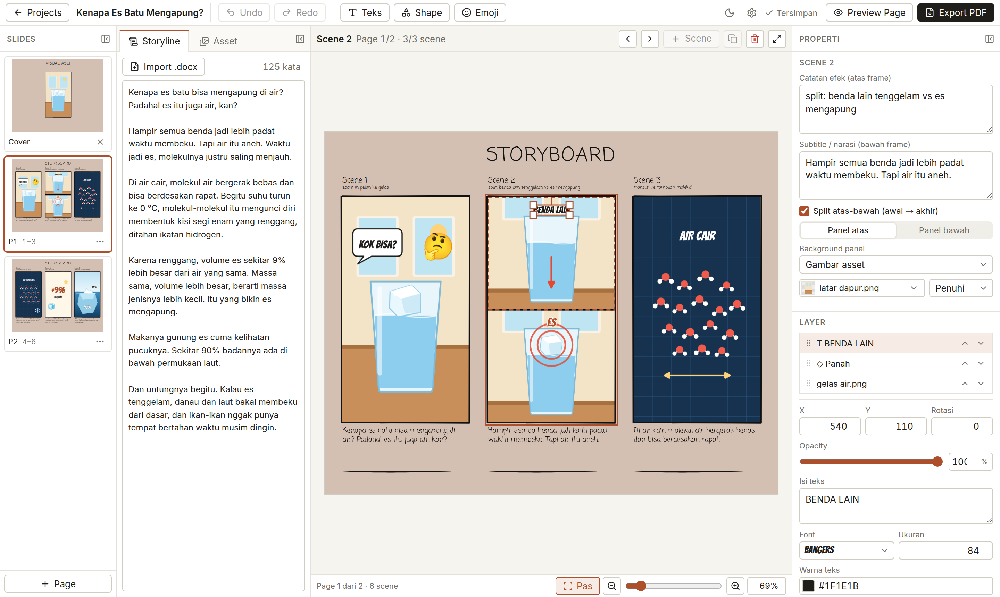
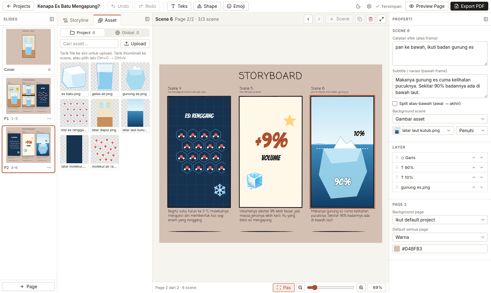
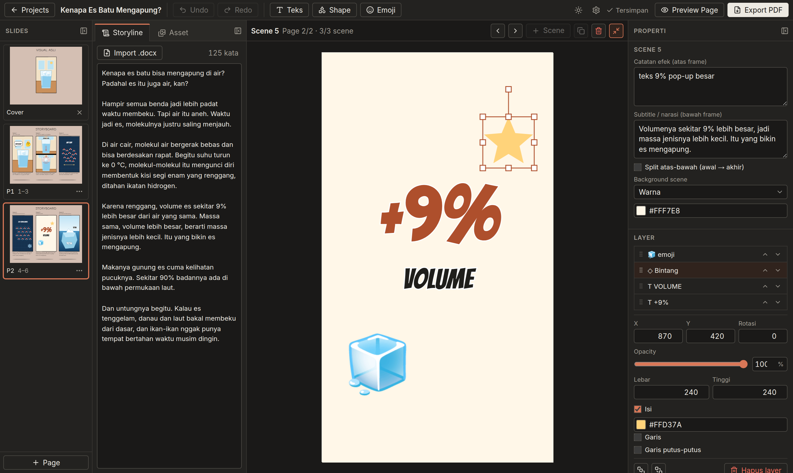
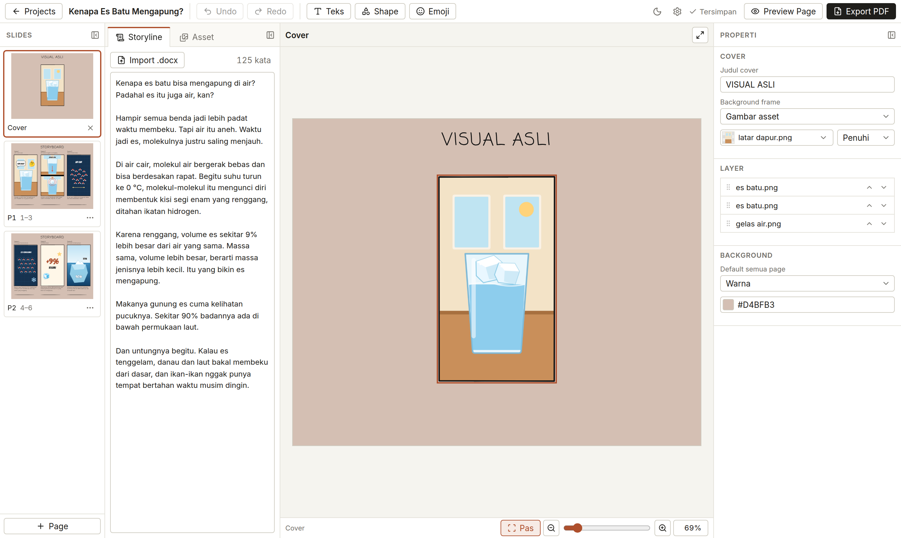
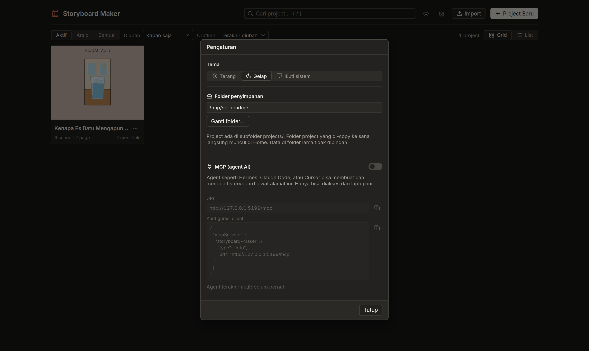
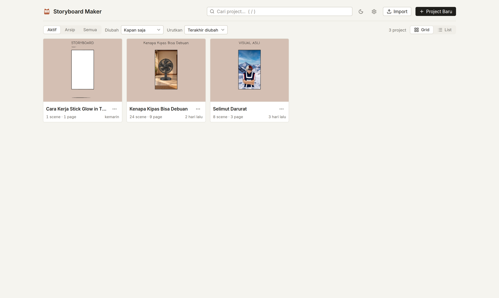
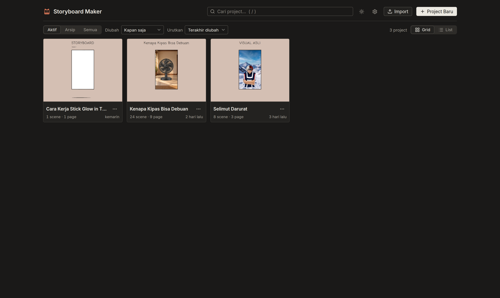

<div align="center">

<picture>
  <source media="(prefers-color-scheme: dark)" srcset="docs/images/storyboard-maker-lockup-dark.svg">
  
</picture>

<p align="center">
  <strong>Bikin storyboard video vertikal 9:16 dari naskah, lalu export PDF siap kirim ke video editor. Jalan lokal di laptop, sebagai aplikasi desktop atau di browser.</strong>
</p>

<p align="center">
  
  
  
  
  
  
</p>

</div>

---

## 📸 Antarmuka Aplikasi

Semua contoh editor di bawah memakai storyboard contoh *"Kenapa Es Batu Mengapung?"* dengan ilustrasi yang dibuat khusus untuk dokumentasi ini.

### Editor
Kiri ke kanan: daftar slide (page), naskah storyline, page aktif yang tampil persis seperti PDF, dan properti scene serta layer. Di sini Scene 2 memakai split atas-bawah, dan layer teks "BENDA LAIN" sedang dipilih.

<picture>
  <source media="(prefers-color-scheme: dark)" srcset="docs/images/editor-dark.png">
  
</picture>

### Asset dan zoom scene

| Tab Asset: tarik gambar ke frame scene | Zoom satu scene (`Z`), shape bintang dipilih |
|---|---|
|  |  |

### Cover dan Pengaturan

| Cover "VISUAL ASLI" (opsional, tidak dihitung sebagai scene) | Pengaturan: tema, folder penyimpanan, MCP |
|---|---|
|  |  |

### Home
Daftar project dengan pencarian, filter Aktif/Arsip, urutan, tampilan grid atau list, serta Import project dari `.zip`.

| Terang | Gelap |
|---|---|
|  |  |

---

## ✨ Fitur Utama

- **Aplikasi desktop (Tauri)**: jendela native untuk Windows, macOS, dan Linux, tanpa perlu memasang Node. Versi browser tetap tersedia lewat `pnpm start`.
- **Slide gaya PowerPoint**: tiap page berisi 1–3 scene, ditambah Cover *"VISUAL ASLI"* opsional. Nomor scene berlanjut antar page; tidak ada pemindahan scene otomatis.
- **Frame 9:16 vertikal**: untuk TikTok, Reels, dan Shorts. Tiap scene punya catatan efek di atas, frame di tengah, dan subtitle di bawah. Frame bisa dibagi atas-bawah untuk kondisi awal → akhir.
- **Storyline di samping**: tempel naskah atau import `.docx`, lengkap dengan hitungan kata, lalu salin ke subtitle scene.
- **Asset per project dan global**: upload dengan drag file atau tombol, tarik thumbnail ke frame, atau tempel screenshot dari clipboard.
- **Layer**: gambar (PNG/JPG/GIF/WebP), teks (15 font bawaan + font laptop), 12 shape (kotak, elips, garis, panah, target, silang, bintang, balon kata, panah putar), dan emoji. Geser, ubah ukuran, putar, flip, opacity, grup, serta urutkan dengan drag di daftar layer.
- **Folder penyimpanan bebas**: pilih sendiri lokasinya, misalnya `Documents`. Folder project yang di-copy ke sana langsung terbaca.
- **Export / Import `.zip`**: pindahkan project antar laptop atau OS, termasuk gambar yang dipakai.
- **Autosave, undo/redo, zoom 25–400%**.
- **Export PDF**: dirender Chromium, teks tetap bisa dipilih dan dicari.
- **MCP untuk AI agent**: 19 tool agar Claude Code, Cursor, atau Hermes bisa menyusun storyboard. Editor terkunci dan menampilkan perubahan secara live selama agent bekerja.

---

## 🚀 Memulai

### Prasyarat
- **Node.js** 22 atau lebih baru
- **pnpm** 10
- Untuk export PDF: Google Chrome, Chromium, atau Edge yang sudah terpasang. Bila tidak ada, jalankan `pnpm exec playwright install chromium`.

### Instalasi & Menjalankan

```bash
# Clone repository
git clone https://github.com/aribrilliantsyah/storyboard-maker.git
cd storyboard-maker

# Install dependensi
pnpm install

# Jalankan server aplikasi
pnpm start
```

Buka **`http://127.0.0.1:5178`** di browser.

### Aplikasi Desktop (Tauri)

Aplikasi desktop membungkus web app yang sama dalam jendela native (Windows, macOS, Linux). Installer membawa Node dan Playwright sendiri, jadi pengguna tidak perlu memasang apa pun. Export PDF memakai Chrome/Edge yang sudah ada di laptop; bila tidak ada, Chromium headless diunduh sekali saat export pertama.

Prasyarat build: [Rust](https://rustup.rs) dan [prasyarat Tauri](https://v2.tauri.app/start/prerequisites/) untuk OS tersebut (Linux: `webkit2gtk-4.1`).

```bash
pnpm desktop:dev     # jendela desktop dengan build lokal
pnpm desktop:build   # installer di src-tauri/target/release/bundle/
```

Installer dibuat per OS: jalankan `pnpm desktop:build` di Windows untuk `.msi`/`.exe`, di macOS untuk `.dmg`, di Linux untuk `.deb`/`.rpm`/`.AppImage`. Binary Node yang ikut dibundel diambil dari Node yang menjalankan build.

#### Pasang di launcher Linux tanpa sudo

Untuk distro tanpa `dpkg` (Arch, CachyOS, Fedora), isi `.deb` bisa dipasang per user di `~/.local`:

```bash
pnpm exec tauri build --bundles deb
mkdir -p /tmp/sbm && cd /tmp/sbm
bsdtar -xf "$OLDPWD/src-tauri/target/release/bundle/deb/Storyboard Maker_0.1.0_amd64.deb" && bsdtar -xf data.tar.*
cp -a "usr/lib/Storyboard Maker" ~/.local/lib/
install -m755 usr/bin/storyboard-maker ~/.local/bin/
cp -a usr/share/icons/hicolor/. ~/.local/share/icons/hicolor/
sed "s|^Exec=.*|Exec=$HOME/.local/bin/storyboard-maker|" "usr/share/applications/Storyboard Maker.desktop" > ~/.local/share/applications/storyboard-maker.desktop
update-desktop-database ~/.local/share/applications
```

Aplikasi lalu muncul di menu aplikasi sebagai **Storyboard Maker**. Untuk menghapus, hapus keempat lokasi di atas.

---

## 📂 Struktur Penyimpanan Data

Seluruh data proyek dan aset disimpan secara lokal di **folder penyimpanan**. Default `~/Storyboard` (Windows: `C:\Users\<nama>\Storyboard`). Ganti lewat ⚙ **Pengaturan → Folder penyimpanan → Ganti folder…** (misalnya ke `Documents` atau folder yang disinkron cloud). Pilihan disimpan per OS di folder konfigurasi aplikasi (`%APPDATA%\storyboard-maker`, `~/Library/Application Support/storyboard-maker`, atau `~/.config/storyboard-maker`). Data di folder lama tidak dipindah. Variabel environment `STORYBOARD_HOME`, bila diisi, selalu menang atas pilihan ini.

```text
~/Storyboard/
├── library/                           # Aset global perpustakaan
├── settings.json                      # Pengaturan global & konfigurasi MCP
└── projects/
    └── <slug-proyek>/
        ├── project.json               # Struktur data storyboard & layer
        ├── storyline.txt              # Naskah cerita proyek
        ├── assets/                    # File aset gambar proyek
        ├── clips/                     # Gambar clipboard sementara
        └── exports/
            └── storyboard.pdf         # Hasil export PDF
```

- **Copy folder**: salin folder `projects/<slug>/` ke `projects/` di folder penyimpanan lain, dan project langsung muncul di Home. Nama folder harus huruf kecil, angka, dan `-`.
- **Export / Import .zip**: menu ⋯ project → **Export (.zip)…**, lalu di laptop lain klik **Import** di Home. Zip berisi `project.json`, storyline, `assets/`, dan `clips/`. Asset global (library) yang dipakai project ikut disalin ke `assets/` agar tidak hilang di laptop lain. Import tidak pernah menimpa project yang sudah ada; slug bentrok diberi akhiran `-2`.

---

## ⌨️ Pintasan Keyboard (Shortcuts)

| Tombol | Fungsi |
|---|---|
| `Ctrl + Z` / `Ctrl + Y` | Undo / Redo aksi |
| `Ctrl + Shift + Z` | Alternatif Redo |
| `Ctrl + =` / `Ctrl + -` | Perbesar / Perkecil kanvas (Zoom in / out) |
| `Ctrl + 0` | Sesuaikan ukuran kanvas ke layar (Fit to screen) |
| `Delete` / `Backspace` | Hapus layer yang sedang dipilih |
| `Ctrl + D` | Duplikat layer terpilih |
| `Ctrl + A` | Pilih semua layer di panel aktif |
| `Shift` / `Ctrl` + klik, atau tarik kotak di area kosong | Pilih beberapa layer |
| `Ctrl + G` / `Ctrl + Shift + G` | Grup / pisahkan grup layer |
| `]` / `[` | Naikkan / turunkan urutan layer (`Shift` = paling depan/belakang) |
| `Panah (Arrow keys)` | Geser posisi layer 5px (`Shift` = 50px) |
| `Ctrl + C` / `Ctrl + V` | Salin dan tempel layer antar scene |
| `Ctrl + X` | Potong (cut) layer |
| `Z` / Double-click frame | Zoom fokus ke satu scene tertentu |
| `Esc` | Batalkan seleksi / keluar dari mode zoom |
| `Ctrl + 1` / `2` / `3` | Toggle sembunyikan/tampilkan panel Slides, Storyline, Properti |
| `←` / `→` di tab Storyline/Asset | Pindah tab |

---

## 🤖 Integrasi AI Agent (MCP Server)

Storyboard Maker dilengkapi server **Model Context Protocol (MCP)** bawaan untuk integrasi langsung dengan AI coding agent.

### Mengaktifkan MCP
1. Buka ⚙ **Pengaturan** di kanan atas aplikasi.
2. Nyalakan switch **MCP (agent AI)**.
3. Konfigurasikan pada client agent pilihan Anda:

```json
{
  "mcpServers": {
    "storyboard-maker": {
      "type": "http",
      "url": "http://127.0.0.1:5178/mcp"
    }
  }
}
```

*Contoh Claude Code:*
```bash
claude mcp add --transport http storyboard-maker http://127.0.0.1:5178/mcp
```

### 19 Tools yang Tersedia untuk AI:
- **Proyek**: `list_projects`, `create_project`, `get_project`, `get_storyline`, `set_storyline`, `list_assets`
- **Halaman & Scene**: `add_page`, `remove_page`, `add_scene`, `remove_scene`, `update_scene`, `set_cover`, `set_background`
- **Manipulasi Layer**: `add_layer`, `update_layer`, `remove_layer`, `reorder_layer`
- **Output & Sesi**: `export_pdf`, `finish_editing`

*Catatan Keamanan*: Server MCP hanya mendengarkan pada antarmuka lokal `127.0.0.1` dan menolak akses dari host eksternal.

---

## 🛠️ Pengembangan (Development)

```bash
# Menjalankan mode pengembangan (Server :5178 + Vite HMR :5173)
pnpm dev

# Menjalankan unit test & test export PDF
pnpm test

# Menjalankan pengujian End-to-End Playwright
pnpm e2e

# Validasi tipe TypeScript
pnpm typecheck
```

---

## 📄 Lisensi

Didistribusikan di bawah lisensi MIT.
