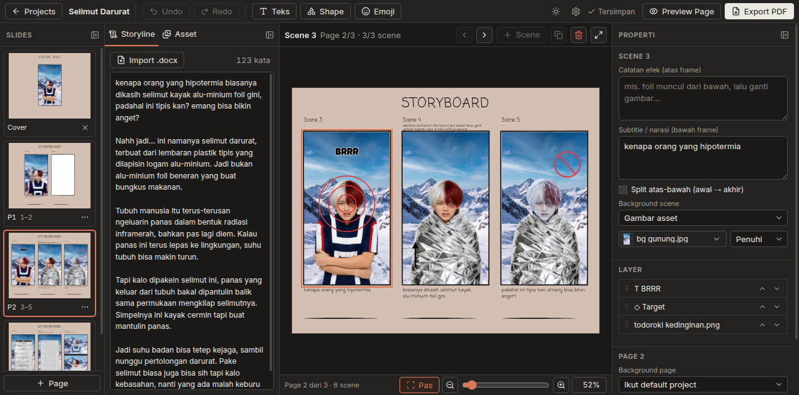

<div align="center">

<picture>
  <source media="(prefers-color-scheme: dark)" srcset="docs/images/storyboard-maker-lockup-dark.svg">
  
</picture>

<p align="center">
  <strong>Aplikasi desktop web lokal untuk merancang storyboard video vertikal 9:16 dari storyline dan export PDF bergaya template Canva untuk video editor.</strong>
</p>

<p align="center">
  
  
  
  
  
  
</p>

</div>

---

## 📸 Antarmuka Aplikasi

### Editor Storyboard (Dark Mode — 3 Scene per Halaman)
Tampilan lembar kerja utama dengan thumbnail navigasi slide di kiri, naskah storyline di tengah-kiri, kanvas 9:16 di tengah, dan inspektor layer di kanan.



### Dashboard Proyek
Manajemen proyek dengan filter status, pencarian instan, pengurutan, dan pergantian tema terang/gelap.

| Tampilan Terang (Light Mode) | Tampilan Gelap (Dark Mode) |
|---|---|
|  |  |

### Manajemen Aset & Pengaturan Integrasi AI (MCP)

| Panel Aset Drag & Drop | Dialog Pengaturan & MCP Server |
|---|---|
|  |  |

---

## ✨ Fitur Utama

- **Navigasi Slides Gaya PowerPoint**: Panel slides di sebelah kiri untuk berpindah halaman dengan cepat. Mendukung Cover *"VISUAL ASLI"* opsional dan halaman isi.
- **Rasio Asli 9:16 Vertikal**: Didesain khusus untuk produksi konten vertikal (TikTok, Instagram Reels, YouTube Shorts).
- **Layout Fleksibel 1–3 Scene per Halaman**: Setiap halaman menampung 1 hingga 3 frame scene tanpa pemindahan otomatis antar halaman.
- **Struktur Scene Lengkap**: Catatan pengarah/efek di atas frame, frame visual 9:16 di tengah, dan subtitle/narasi di bawah frame. Mendukung split atas-bawah (kondisi awal → akhir).
- **Integrasi Storyline & Import Word (`.docx`)**: Baca naskah cerita di panel samping dengan penghitung kata otomatis dan kemudahan copy-paste ke scene.
- **Manajemen Aset Komprehensif**: Asset per proyek dan asset global perpustakaan, drag & drop ke canvas, serta copy-paste screenshot clipboard langsung jadi file asset.
- **Manipulasi Layer Kaya**:
  - Transformasi: geser, ubah ukuran, putar, flip horizontal/vertikal, opacity.
  - Tipe layer: Gambar (PNG/JPG/GIF/WebP), Teks (15 font bawaan + font lokal sistem di Chrome), 10 bentuk shape (kotak, elips, garis, panah, target, silang, bintang, balon kata), dan Emoji picker.
- **Autosave & Undo/Redo Penuh**: Riwayat aksi tersimpan otomatis (`Ctrl+Z`, `Ctrl+Shift+Z`, `Ctrl+Y`), dengan indikator status sinkronisasi.
- **Zoom Kanvas Presisi**: Rentang zoom 25%–400% dengan slider, tombol pintas, dan mode fokus *"Pas layar"*.
- **Export PDF Berkualitas Tinggi**: Render PDF bergaya Canva secara otomatis via browser Chromium bawaan (Playwright).
- **Protokol AI Agent (MCP)**: Server Model Context Protocol bawaan dengan 19 tools untuk automasi pembuatan storyboard melalui AI agent (Hermes, Claude Code, Cursor).

---

## 🚀 Memulai

### Prasyarat
- **Node.js** v20 atau lebih baru
- **pnpm** (direkomendasikan)
- Browser Chromium untuk export PDF (Playwright)

### Instalasi & Menjalankan

```bash
# Clone repository
git clone https://github.com/aribrilliantsyah/storyboard-maker.git
cd storyboard-maker

# Install dependensi
pnpm install

# Jalankan server aplikasi
pnpm start
```

Aplikasi web dapat langsung diakses melalui peramban di:
👉 **`http://127.0.0.1:5178`**

Untuk export PDF, pastikan Chromium Playwright telah terpasang:
```bash
pnpm exec playwright install chromium
```

### Aplikasi Desktop (Tauri)

Aplikasi desktop membungkus web app yang sama dalam jendela native (Windows, macOS, Linux). Installer membawa Node dan Playwright sendiri, jadi pengguna tidak perlu memasang apa pun. Export PDF memakai Chrome/Edge yang sudah ada di laptop; bila tidak ada, Chromium headless diunduh sekali saat export pertama.

Prasyarat build: [Rust](https://rustup.rs) dan [prasyarat Tauri](https://v2.tauri.app/start/prerequisites/) untuk OS tersebut (Linux: `webkit2gtk-4.1`).

```bash
pnpm desktop:dev     # jendela desktop dengan build lokal
pnpm desktop:build   # installer di src-tauri/target/release/bundle/
```

Installer dibuat per OS: jalankan `pnpm desktop:build` di Windows untuk `.msi`/`.exe`, di macOS untuk `.dmg`, di Linux untuk `.deb`/`.rpm`/`.AppImage`. Binary Node yang ikut dibundel diambil dari Node yang menjalankan build.

---

## 📂 Struktur Penyimpanan Data

Seluruh data proyek dan aset disimpan secara lokal di **folder penyimpanan**. Default `~/Storyboard` (Windows: `C:\Users\<nama>\Storyboard`). Ganti lewat ⚙ **Pengaturan → Folder penyimpanan → Ganti folder…** (misalnya ke `Documents` atau folder yang disinkron cloud). Pilihan disimpan per OS di folder konfigurasi aplikasi (`%APPDATA%\storyboard-maker`, `~/Library/Application Support/storyboard-maker`, atau `~/.config/storyboard-maker`). Data di folder lama tidak dipindah. Variabel environment `STORYBOARD_HOME`, bila diisi, selalu menang atas pilihan ini.

```text
~/Storyboard/
├── library/                           # Aset global perpustakaan
├── settings.json                      # Pengaturan global & konfigurasi MCP
└── projects/
    └── <slug-proyek>/
        ├── project.json               # Struktur data storyboard & layer
        ├── storyline.txt              # Naskah cerita proyek
        ├── assets/                    # File aset gambar proyek
        ├── clips/                     # Gambar clipboard sementara
        └── exports/
            └── storyboard.pdf         # Hasil export PDF
```

- **Copy folder**: salin folder `projects/<slug>/` ke `projects/` di folder penyimpanan lain, dan project langsung muncul di Home. Nama folder harus huruf kecil, angka, dan `-`.
- **Export / Import .zip**: menu ⋯ project → **Export (.zip)…**, lalu di laptop lain klik **Import** di Home. Zip berisi `project.json`, storyline, `assets/`, dan `clips/`. Asset global (library) yang dipakai project ikut disalin ke `assets/` agar tidak hilang di laptop lain. Import tidak pernah menimpa project yang sudah ada; slug bentrok diberi akhiran `-2`.

---

## ⌨️ Pintasan Keyboard (Shortcuts)

| Tombol | Fungsi |
|---|---|
| `Ctrl + Z` / `Ctrl + Y` | Undo / Redo aksi |
| `Ctrl + Shift + Z` | Alternatif Redo |
| `Ctrl + =` / `Ctrl + -` | Perbesar / Perkecil kanvas (Zoom in / out) |
| `Ctrl + 0` | Sesuaikan ukuran kanvas ke layar (Fit to screen) |
| `Delete` / `Backspace` | Hapus layer yang sedang dipilih |
| `Ctrl + D` | Duplikat layer terpilih |
| `]` / `[` | Naikkan / turunkan urutan layer (`Shift` = paling depan/belakang) |
| `Panah (Arrow keys)` | Geser posisi layer 5px (`Shift` = 50px) |
| `Ctrl + C` / `Ctrl + V` | Salin dan tempel layer antar scene |
| `Ctrl + X` | Potong (cut) layer |
| `Z` / Double-click frame | Zoom fokus ke satu scene tertentu |
| `Esc` | Batalkan seleksi / keluar dari mode zoom |
| `Ctrl + 1` / `2` / `3` | Toggle sembunyikan/tampilkan panel Slides, Storyline, Properti |

---

## 🤖 Integrasi AI Agent (MCP Server)

Storyboard Maker dilengkapi server **Model Context Protocol (MCP)** bawaan untuk integrasi langsung dengan AI coding agent.

### Mengaktifkan MCP
1. Buka ⚙ **Pengaturan** di kanan atas aplikasi.
2. Aktifkan opsi **Model Context Protocol (MCP)**.
3. Konfigurasikan pada client agent pilihan Anda:

```json
{
  "mcpServers": {
    "storyboard-maker": {
      "type": "http",
      "url": "http://127.0.0.1:5178/mcp"
    }
  }
}
```

*Contoh Claude Code:*
```bash
claude mcp add --transport http storyboard-maker http://127.0.0.1:5178/mcp
```

### 19 Tools yang Tersedia untuk AI:
- **Proyek**: `list_projects`, `create_project`, `get_project`, `get_storyline`, `set_storyline`, `list_assets`
- **Halaman & Scene**: `add_page`, `remove_page`, `add_scene`, `remove_scene`, `update_scene`, `set_cover`, `set_background`
- **Manipulasi Layer**: `add_layer`, `update_layer`, `remove_layer`, `reorder_layer`
- **Output & Sesi**: `export_pdf`, `finish_editing`

*Catatan Keamanan*: Server MCP hanya mendengarkan pada antarmuka lokal `127.0.0.1` dan menolak akses dari host eksternal.

---

## 🛠️ Pengembangan (Development)

```bash
# Menjalankan mode pengembangan (Server :5178 + Vite HMR :5173)
pnpm dev

# Menjalankan unit test & test export PDF
pnpm test

# Menjalankan pengujian End-to-End Playwright
pnpm e2e

# Validasi tipe TypeScript
pnpm typecheck
```

---

## 📄 Lisensi

Didistribusikan di bawah lisensi MIT.
