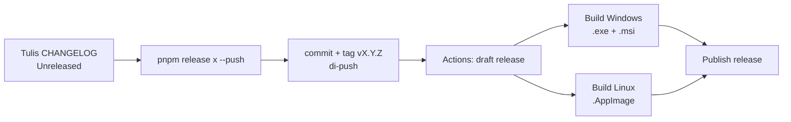

# Panduan push, build, dan rilis di GitHub

Repo: `git@github.com:aribrilliantsyah/stomek.git` (branch `main`).

Build installer tidak dilakukan di laptop. GitHub Actions membangunnya setiap kali ada **tag versi** (`v0.1.0`, `v0.2.3`, …) yang di-push. Push commit biasa ke `main` tidak memicu build.



## 1. Persiapan sekali saja

1. **Login GitHub di terminal** (opsional, untuk memantau build dari terminal): pasang [GitHub CLI](https://cli.github.com), lalu `gh auth login`.
2. **Izin Actions**: buka repo di GitHub → **Settings → Actions → General**.
   - *Actions permissions*: **Allow all actions and reusable workflows** (workflow memakai action dari `actions/`, `pnpm/`, `dtolnay/`, `swatinem/`, dan `tauri-apps/`).
   - *Workflow permissions*: pilih **Read and write permissions**. Workflow butuh izin ini untuk membuat Release dan mengunggah installer.
3. **Push kode pertama kali**:

   ```bash
   git push -u origin main
   ```

## 2. Push perubahan sehari-hari

```bash
git add -A
git commit -m "fix: deskripsi singkat"
git push
```

Sambil bekerja, tulis setiap perubahan yang terlihat pengguna di `CHANGELOG.md` di bawah `## [Unreleased]`, dikelompokkan dengan `### Added` / `### Changed` / `### Fixed`. Isi bagian ini nanti tampil di halaman download.

## 3. Membuat rilis (build installer)

Syarat: semua perubahan sudah di-commit dan bagian `## [Unreleased]` tidak kosong.

```bash
pnpm release patch --push   # 0.1.0 → 0.1.1  (perbaikan)
pnpm release minor --push   # 0.1.0 → 0.2.0  (fitur baru)
pnpm release major --push   # 0.1.0 → 1.0.0  (perubahan besar)
pnpm release 1.4.0 --push   # versi tertentu
```

**Rilis pertama**: `package.json` sudah berisi `0.1.0`, jadi jalankan `pnpm release 0.1.0 --push`.

Yang dilakukan script:

1. Mengubah versi di `package.json`, `src-tauri/Cargo.toml`, dan `src-tauri/Cargo.lock`.
2. Memindahkan isi *Unreleased* ke `## [x.y.z] - tanggal` di `CHANGELOG.md`.
3. Commit `release: vX.Y.Z`, lalu membuat tag `vX.Y.Z`.
4. `git push --follow-tags`, yang memicu workflow build.

Tanpa `--push`, periksa dulu hasilnya (`git show`), lalu push sendiri dengan `git push --follow-tags`.

## 4. Memantau build

- Di browser: tab **Actions** → workflow **Release** → run untuk tag tersebut.
- Di terminal:

  ```bash
  gh run watch          # pilih run yang sedang berjalan
  gh run list --workflow release.yml
  ```

Urutan job dan perkiraan waktu (run pertama lebih lama karena cache Rust masih kosong):

| Job | Isi | Perkiraan |
|---|---|---|
| Draft release | cek tag = versi `package.json`, susun catatan rilis dari CHANGELOG, buat Release draft | < 1 menit |
| Build (Windows) | `.exe` (NSIS) + `.msi` di `windows-latest` | 10–20 menit |
| Build (Linux AppImage) | `.AppImage` di `ubuntu-22.04` | 10–20 menit |
| Publish release | draft → rilis publik, ditandai *Latest* | < 1 menit |

## 5. Hasil dan download

Setelah semua job hijau, buka **Releases** (`https://github.com/aribrilliantsyah/stomek/releases/latest`). Halaman ini berisi tabel link download dan changelog versi tersebut:

| File | Untuk |
|---|---|
| `Stomake_<versi>_x64-setup.exe` | Windows 10/11, installer biasa (disarankan) |
| `Stomake_<versi>_x64_en-US.msi` | Windows, untuk instalasi lewat IT/GPO |
| `Stomake_<versi>_amd64.AppImage` | Linux x64: `chmod +x`, lalu jalankan |

Badge **download** di README otomatis menampilkan versi terbaru.

## 6. Kalau ada masalah

| Gejala | Penyebab | Solusi |
|---|---|---|
| `release: working tree is not clean` | ada perubahan belum di-commit | commit atau `git stash` dulu |
| `"## [Unreleased]" is empty` | changelog belum diisi | tulis perubahan di CHANGELOG, commit, ulangi |
| `tag vX.Y.Z already exists` | versi itu sudah pernah dirilis | pakai versi berikutnya |
| Job *Draft release* gagal: `tag … != package.json` | tag dibuat manual, tidak lewat `pnpm release` | hapus tag (lihat bawah), pakai `pnpm release` |
| Job *Draft release* gagal saat membuat release (403) | izin workflow masih *read-only* | aktifkan **Read and write permissions** (langkah 1.2), lalu **Re-run all jobs** |
| Salah satu build merah | error kompilasi/bundle di OS itu | buka log job tersebut. Release tetap **draft**, jadi pengguna tidak melihat rilis setengah jadi |

**Mengulang rilis yang gagal** (versi sama, setelah memperbaiki kode):

```bash
gh release delete vX.Y.Z --yes          # hapus draft (atau lewat halaman Releases)
git push --delete origin vX.Y.Z         # hapus tag di GitHub
git tag -d vX.Y.Z                       # hapus tag lokal
git revert --no-edit HEAD               # batalkan commit "release: vX.Y.Z" tanpa force push
# perbaiki kode, commit, lalu:
pnpm release X.Y.Z --push
```

`git revert` mengembalikan versi dan isi *Unreleased* di CHANGELOG seperti sebelum rilis, jadi `pnpm release` bisa dijalankan lagi dengan versi yang sama. Jalankan revert sebelum commit perbaikan agar `HEAD` masih commit rilisnya.

Kalau masalahnya hanya gangguan sementara (misalnya runner timeout), cukup buka run yang gagal → **Re-run failed jobs**, tanpa menghapus apa pun.

## 7. Build lokal (tanpa GitHub)

Untuk mencoba installer sebelum rilis. Hanya bisa membuat installer untuk OS yang sedang dipakai:

```bash
pnpm exec tauri build --bundles appimage     # Linux → src-tauri/target/release/bundle/appimage/
pnpm exec tauri build --bundles nsis,msi     # Windows → src-tauri\target\release\bundle\{nsis,msi}\
```

Prasyaratnya: Rust dan [prasyarat Tauri](https://v2.tauri.app/start/prerequisites/). Di Linux dengan AppImageLauncher, jalankan dengan `APPIMAGELAUNCHER_DISABLE=1 ./Stomake_*.AppImage` agar tidak muncul dialog integrasi.

## Catatan

- Installer Windows **belum ditandatangani** (code signing), jadi SmartScreen menampilkan peringatan *Windows protected your PC*; pengguna memilih *More info → Run anyway*. Untuk menghilangkannya diperlukan sertifikat code signing berbayar.
- macOS belum ikut di workflow. Untuk menambahkannya, tambah baris `macos-latest` di `matrix` pada `.github/workflows/release.yml`, ditambah notarization Apple bila ingin bebas peringatan Gatekeeper.
- Node yang dibundel ke installer adalah Node 24 dari runner (`actions/setup-node`), bukan Node di laptop Anda.
